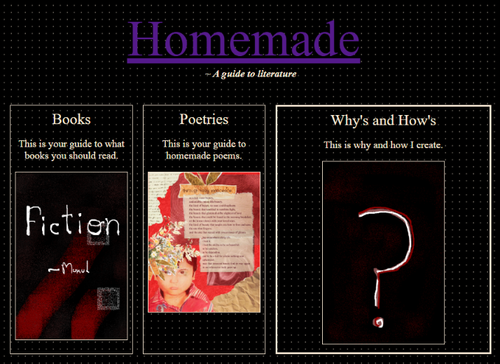
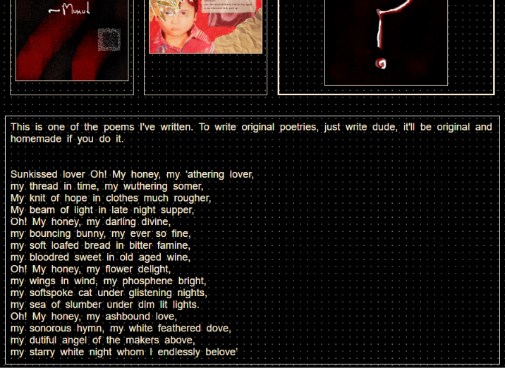
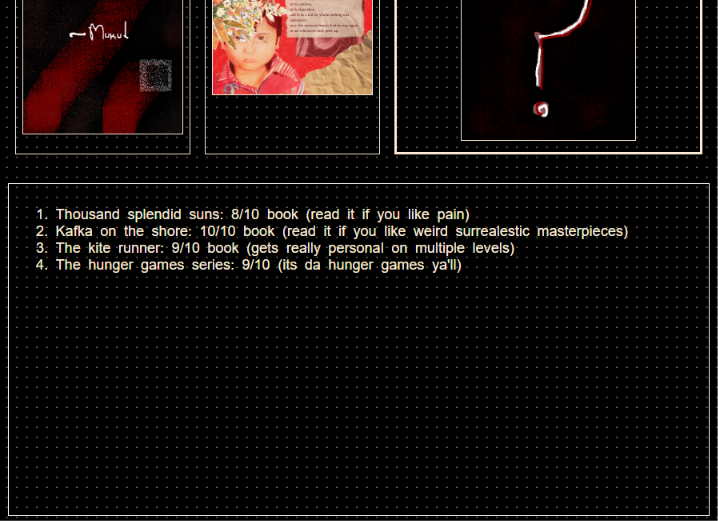

# Homemade
**coded by: Mukul**

I have coded this personal website to show my love for literature i think.
# My demo link
[https://mukul-mittal-art.github.io/Homemade/](https://mukul-mittal-art.github.io/Homemade/)

# Tech stack
Program used: Visual Studio Code
Languages used: CSS and HTML

# What does it do?
makes me happy. (jk)
It's a project that shows my view on poetries, books I love and recommend, and why and how I consume and participate in literature.

# How did i make it?
* I made a rough sketch on paper on how i want it to look
* I created all necessary files.
* Then, i began with index.html and added main heading text.
* From then, i added a div system to divide sections and added page links.
* I added my content and finished with several minor finishing touches.

# AI USAGE
None


# Screenshots




# How to run the project locally
Clone and run this repository:
```bash
git clone https://github.com/mukul-mittal-art/Homemade.git